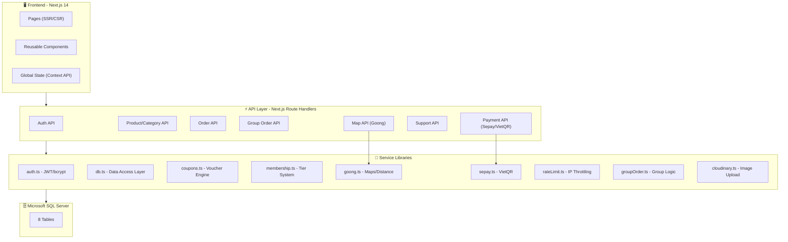
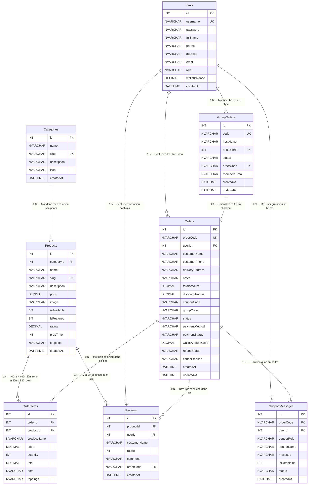

# 📋 BÁO CÁO PHÂN TÍCH TOÀN DIỆN DỰ ÁN NOONEE FOOD

> **Dự án:** NooNee Food Ordering Web  
> **Công nghệ:** Next.js 14 + TypeScript + Tailwind CSS + Microsoft SQL Server  
> **Ngày phân tích:** 17/09/2026  

---

## MỤC LỤC

1. [Tổng quan kiến trúc](#1-tổng-quan-kiến-trúc)
2. [Danh sách tính năng (Functional Requirements)](#2-danh-sách-tính-năng-functional-requirements)
3. [Yêu cầu phi tính năng (Non-Functional Requirements)](#3-yêu-cầu-phi-tính-năng-non-functional-requirements)
4. [Bảng cơ sở dữ liệu (Database Schema)](#4-bảng-cơ-sở-dữ-liệu-database-schema)
5. [Bảng quan hệ CSDL (Entity Relationship Diagram)](#5-bảng-quan-hệ-csdl-entity-relationship-diagram)
6. [Danh sách API Endpoints](#6-danh-sách-api-endpoints)

---

## 1. TỔNG QUAN KIẾN TRÚC

### Stack công nghệ

| Thành phần | Công nghệ |
|:---|:---|
| **Framework** | Next.js 14.2.15 (App Router) |
| **Ngôn ngữ** | TypeScript 5.6 |
| **UI/Styling** | Tailwind CSS 3.4 + Framer Motion |
| **Database** | Microsoft SQL Server (Cloud - MonsterASP) |
| **DB Driver** | mssql 11.0.1 |
| **Authentication** | JWT (jsonwebtoken) + bcryptjs |
| **Thanh toán** | VietQR / Sepay |
| **Bản đồ** | Goong.io API |
| **Upload ảnh** | Cloudinary |
| **Icons** | Lucide React + React Icons |
| **QR Code** | qrcode library |

---

## 2. DANH SÁCH TÍNH NĂNG (Functional Requirements)

### 2.1. 👤 QUẢN LÝ NGƯỜI DÙNG & XÁC THỰC

| # | Tính năng | Mô tả chi tiết | Trang/Component |
|:--|:----------|:----------------|:----------------|
| F01 | **Đăng ký tài khoản** | Đăng ký với username, mật khẩu (yêu cầu ≥8 ký tự, chữ hoa, chữ thường, số, ký tự đặc biệt), họ tên, SĐT, email, địa chỉ. Kiểm tra username trùng. | `/register` |
| F02 | **Đăng nhập** | Đăng nhập bằng username/password, tạo JWT token (hết hạn 7 ngày), lưu cookie `auth_token`. | `/login` |
| F03 | **Đăng xuất** | Xóa token và cookie, reset state toàn cục. | `Navbar` |
| F04 | **Xem hồ sơ cá nhân** | Dashboard 4 tab: Hạng thành viên/Thống kê, Món yêu thích, Đổi mật khẩu, Thông tin cá nhân. | `/profile` |
| F05 | **Cập nhật thông tin** | Sửa họ tên, SĐT, địa chỉ (null-safe update bằng `COALESCE`). | `/profile` |
| F06 | **Đổi mật khẩu** | Xác minh mật khẩu hiện tại trước khi hash và lưu mật khẩu mới. | `/profile` |
| F07 | **Ví ảo (Virtual Wallet)** | Mỗi user có số dư ví ảo (VND), dùng thanh toán đơn hàng, nhận hoàn tiền khi hủy đơn. | `/profile`, `/checkout` |
| F08 | **Hệ thống hạng thành viên** | 4 hạng: Bronze → Silver → Gold → Diamond, dựa trên tổng chi tiêu. Mỗi hạng có voucher riêng. | `/profile`, `membership.ts` |

### 2.2. 🍔 QUẢN LÝ SẢN PHẨM & DANH MỤC

| # | Tính năng | Mô tả chi tiết | Trang/Component |
|:--|:----------|:----------------|:----------------|
| F09 | **Xem danh sách sản phẩm** | Hiển thị sản phẩm theo lưới, phân trang server-side (`OFFSET/FETCH`), kèm tên danh mục. | `/menu` |
| F10 | **Tìm kiếm sản phẩm** | Tìm theo tên hoặc mô tả với SQL `LIKE`. | `/menu` |
| F11 | **Lọc theo danh mục** | Lọc sản phẩm theo category chips ngang cuộn được. | `/menu` |
| F12 | **Sắp xếp theo giá** | Sắp xếp giá tăng/giảm dần. | `/menu` |
| F13 | **Lọc Deals/Nổi bật** | Hiển thị chỉ sản phẩm `isFeatured = 1`. | `/menu` |
| F14 | **Xem chi tiết sản phẩm** | Trang chi tiết: ảnh 1:1, giá, rating, thời gian chuẩn bị, mô tả, topping, sản phẩm liên quan. | `/product/[slug]` |
| F15 | **Chọn topping** | Mỗi sản phẩm có danh sách topping (JSON) với giá riêng. Chọn nhiều topping khi thêm giỏ hàng. | `ProductOptionsModal` |
| F16 | **Ghi chú cho sản phẩm** | Thêm ghi chú nấu ăn cho từng sản phẩm khi thêm giỏ hàng. | `ProductOptionsModal` |
| F17 | **Yêu thích sản phẩm** | Toggle nút ❤️ yêu thích, lưu localStorage, di chuyển từ guest sang user khi đăng nhập. | `FavoriteButton` |
| F18 | **Showcase 3D** | Carousel xoay 360° hiển thị sản phẩm nổi bật trên trang chủ. | `Carousel360` |

### 2.3. 🛒 GIỎ HÀNG & THANH TOÁN

| # | Tính năng | Mô tả chi tiết | Trang/Component |
|:--|:----------|:----------------|:----------------|
| F19 | **Giỏ hàng** | Thêm/xóa/thay đổi số lượng, hiển thị topping đã chọn, tính tổng. Lưu `localStorage`. | `/cart`, `CartDrawer` |
| F20 | **Cart Drawer** | Thanh trượt xem giỏ hàng nhanh từ bất kỳ trang nào. | `CartDrawer` |
| F21 | **Thanh toán (Checkout)** | Form nhập thông tin giao hàng, chọn phương thức thanh toán, áp voucher, dùng ví ảo. | `/checkout` |
| F22 | **Thanh toán VietQR (Sepay)** | Tạo mã QR chuyển khoản ngân hàng, tự động kiểm tra trạng thái thanh toán (polling 3s). | `/payment/[orderCode]` |
| F23 | **Thanh toán COD** | Ship COD - thanh toán khi nhận hàng. | `/checkout` |
| F24 | **Thanh toán Ví ảo** | Trừ tiền từ số dư ví ảo, atomic safe (chống double-spend). | `/checkout` |
| F25 | **Áp mã giảm giá (Coupon)** | Validate coupon: kiểm tra min order, hạng thành viên, new user, payment method. Tính giảm giá cố định hoặc %. | `/checkout`, `coupons.ts` |
| F26 | **Tính phí ship** | Tự động tính dựa trên khoảng cách (Goong API): ≤2km: 15k, 2-10km: 15k+5k/km, >10km: 55k+7k/km. Giới hạn bán kính 15km. | `/checkout`, `goong.ts` |
| F27 | **Autocomplete địa chỉ** | Tìm kiếm và chọn địa chỉ từ Goong Maps API, fallback danh sách địa danh Hà Nội. | `AddressAutocompleteInput` |

### 2.4. 📦 QUẢN LÝ ĐƠN HÀNG

| # | Tính năng | Mô tả chi tiết | Trang/Component |
|:--|:----------|:----------------|:----------------|
| F28 | **Tạo đơn hàng** | ACID Transaction: kiểm tra giá server-side, trừ ví, tạo đơn + chi tiết đơn, rollback nếu lỗi. | API `/api/orders` |
| F29 | **Xem lịch sử đơn hàng** | Danh sách đơn cá nhân (kể cả đơn nhóm đã tham gia), phân trang, tìm kiếm. | `/orders` |
| F30 | **Tra cứu đơn hàng** | Tra cứu bằng mã đơn hàng (không cần đăng nhập). | `/orders` |
| F31 | **Xem chi tiết đơn hàng** | Hiển thị toàn bộ thông tin: sản phẩm, giá, topping, trạng thái, phương thức thanh toán. | `/orders/[orderCode]` |
| F32 | **Hủy đơn hàng** | Chỉ hủy đơn `Pending`, tự động hoàn tiền vào ví ảo (gateway + wallet amount). | `/orders/[orderCode]` |
| F33 | **Trạng thái đơn hàng** | 5 trạng thái: Pending → Processing → Delivering → Completed / Cancelled. Badge màu sắc. | `/orders` |

### 2.5. 👥 ĐƠN HÀNG NHÓM (Group Order)

| # | Tính năng | Mô tả chi tiết | Trang/Component |
|:--|:----------|:----------------|:----------------|
| F34 | **Tạo phòng nhóm** | Host tạo phòng, sinh mã dạng `NN-XXXX`, tối đa 10 thành viên. | `/group` |
| F35 | **Tham gia nhóm** | Nhập mã phòng để tham gia, hoặc re-join nếu đã tham gia trước đó. | `/group` |
| F36 | **Thêm/sửa/xóa món trong nhóm** | Mỗi thành viên quản lý món của mình, server validate giá thật từ DB. | `/group/[code]` |
| F37 | **Xóa thành viên** | Host có quyền kick thành viên (không thể kick chính mình). | `/group/[code]` |
| F38 | **Khóa/Mở khóa nhóm** | Host lock khi đủ ≥2 người để checkout, unlock để chỉnh sửa tiếp. | `/group/[code]` |
| F39 | **Giảm giá nhóm** | Tự động: 3+ người → 2%, 5+ người → 5%, 10 người → 10%. | `groupOrder.ts` |
| F40 | **Checkout nhóm** | Host checkout toàn bộ đơn nhóm, áp giảm giá nhóm vào tổng tiền. | `/checkout` |

### 2.6. ⭐ ĐÁNH GIÁ & HỖ TRỢ

| # | Tính năng | Mô tả chi tiết | Trang/Component |
|:--|:----------|:----------------|:----------------|
| F41 | **Đánh giá sản phẩm** | Xác minh đã mua hàng trước khi cho phép đánh giá. Upsert (tạo mới/cập nhật). Rating 1-5 sao. | `ProductReviewsSection` |
| F42 | **Tự động tính rating** | Khi đánh giá, tự động tính lại `AVG(rating)` của sản phẩm trong cùng SQL batch. | `db.ts` |
| F43 | **Xem đánh giá** | Danh sách đánh giá trên trang chi tiết sản phẩm, sắp xếp mới nhất. | `/product/[slug]` |
| F44 | **Hỗ trợ khách hàng** | Hệ thống chat/ticket giữa customer và admin, gắn với mã đơn hàng. | `/admin/support` |
| F45 | **Khiếu nại** | Đánh dấu tin nhắn là complaint (`isComplaint`), trạng thái open/resolved. | API `/api/support` |

### 2.7. 🔧 QUẢN TRỊ (ADMIN)

| # | Tính năng | Mô tả chi tiết | Trang/Component |
|:--|:----------|:----------------|:----------------|
| F46 | **Dashboard tổng quan** | Doanh thu, tổng đơn, đơn chờ, đơn đang giao, tổng sản phẩm, 10 đơn gần nhất. | `/admin` |
| F47 | **Quản lý danh mục** | CRUD danh mục: tên, slug, mô tả, icon. Xóa danh mục → sản phẩm set categoryId = NULL. | `/admin/categories` |
| F48 | **Quản lý sản phẩm** | CRUD sản phẩm: tên, slug, giá, ảnh (Cloudinary), mô tả, topping, thời gian chuẩn bị, trạng thái. | `/admin/products` |
| F49 | **Quản lý đơn hàng** | Xem tất cả đơn, lọc theo trạng thái, cập nhật trạng thái (Processing/Delivering/Completed). | `/admin/orders` |
| F50 | **Quản lý hỗ trợ** | Xem và trả lời tin nhắn hỗ trợ/khiếu nại, đánh dấu resolved. | `/admin/support` |
| F51 | **Chẩn đoán hệ thống** | Kiểm tra kết nối DB, đếm bản ghi các bảng, thông tin engine. | `/admin/diagnostics` |
| F52 | **Đăng nhập Admin** | Trang login riêng cho admin, kiểm tra role = 'admin'. | `/admin/login` |
| F53 | **Upload ảnh** | Upload ảnh sản phẩm lên Cloudinary. | API `/api/upload` |

### 2.8. 🎨 GIAO DIỆN & TRẢI NGHIỆM

| # | Tính năng | Mô tả chi tiết | Component |
|:--|:----------|:----------------|:----------|
| F54 | **Responsive Design** | Giao diện thích ứng mobile/tablet/desktop với Tailwind CSS. | Global |
| F55 | **Navbar thông minh** | Menu điều hướng, hiển thị tên user, badge số lượng giỏ hàng, nút đăng nhập/xuất. | `Navbar` |
| F56 | **Footer** | Thông tin liên hệ, giờ mở cửa, liên kết nhanh. | `Footer` |
| F57 | **Banner khuyến mãi** | Thanh banner quảng cáo/thông báo khuyến mãi trên trang chủ. | `PromoBanner` |
| F58 | **Skeleton Loading** | Hiệu ứng loading placeholder khi tải dữ liệu. | `/menu` |
| F59 | **Animation** | Hiệu ứng chuyển động mượt mà bằng Framer Motion. | Global |
| F60 | **Trang 404** | Trang "Không tìm thấy" với thiết kế phù hợp. | `not-found.tsx` |
| F61 | **Trang lỗi** | Trang xử lý lỗi runtime với error boundary. | `error.tsx` |

---

## 3. YÊU CẦU PHI TÍNH NĂNG (Non-Functional Requirements)

### 3.1. 🔒 BẢO MẬT (Security)

| # | Yêu cầu | Mô tả chi tiết | Triển khai |
|:--|:---------|:----------------|:-----------|
| NF01 | **Mã hóa mật khẩu** | Hash mật khẩu bằng bcryptjs với 12 rounds salt. Không lưu plaintext. | `db.ts` - `createUser()` |
| NF02 | **Xác thực JWT** | Token JWT (jsonwebtoken) với thời hạn 7 ngày, hỗ trợ Bearer header và cookie. | `auth.ts` |
| NF03 | **Phân quyền Role-based** | 2 role: `customer` và `admin`. Middleware `requireAdmin()` bảo vệ API admin. | `auth.ts` |
| NF04 | **Rate Limiting** | Giới hạn request theo IP: Login (10/phút), Register (5/phút), Checkout, Group updates. | `rateLimit.ts` |
| NF05 | **Validate server-side giá** | Mọi đơn hàng được kiểm tra giá thật từ DB trước khi tạo, chống gian lận. | `createOrder()` |
| NF06 | **Parameterized Queries** | Tất cả SQL queries sử dụng `sql.Request().input()` với typed parameters, chống SQL injection. | `db.ts` |
| NF07 | **Xác minh đánh giá** | Chỉ cho đánh giá khi đã mua sản phẩm (JOIN `Orders` + `OrderItems`). | `hasUserOrderedProduct()` |
| NF08 | **Kiểm tra mật khẩu mạnh** | Yêu cầu: ≥8 ký tự, chữ hoa, chữ thường, số, ký tự đặc biệt. | API `/api/auth/register` |
| NF09 | **AdminGuard** | Component bảo vệ route admin, redirect nếu không phải admin. | `AdminGuard.tsx` |

### 3.2. ⚡ HIỆU NĂNG (Performance)

| # | Yêu cầu | Mô tả chi tiết | Triển khai |
|:--|:---------|:----------------|:-----------|
| NF10 | **Connection Pooling** | Sử dụng `mssql` connection pool cho kết nối DB hiệu quả. | `db.ts` |
| NF11 | **In-Memory Cache** | Cache đồng bộ trong bộ nhớ cho categories, products, orders để giảm truy vấn DB. | `db.ts` |
| NF12 | **Phân trang SQL** | `OFFSET/FETCH NEXT` cho products và orders, tránh tải toàn bộ bảng. | `getProducts()`, `getOrders()` |
| NF13 | **Single-Pass Aggregation** | Dashboard admin dùng `SUM(CASE WHEN...)` và `COUNT(CASE WHEN...)` trong 1 query. | `getAdminStats()` |
| NF14 | **Client-side Filtering** | Menu page dùng `useMemo` để lọc/sắp xếp trên dữ liệu đã tải, giảm API call. | `/menu` |
| NF15 | **Haversine Fallback** | Nếu Goong API lỗi, tính khoảng cách bằng Haversine (×1.35 cho đường Hà Nội). | `goong.ts` |

### 3.3. 🛡️ ĐỘ TIN CẬY (Reliability)

| # | Yêu cầu | Mô tả chi tiết | Triển khai |
|:--|:---------|:----------------|:-----------|
| NF16 | **ACID Transaction** | Checkout sử dụng `sql.Transaction` với rollback, đảm bảo tính toàn vẹn dữ liệu. | `createOrder()` |
| NF17 | **Atomic Wallet Operations** | Trừ/cộng ví dùng `UPDATE ... WHERE balance >= @amount`, chống double-spend race condition. | `deductUserWallet()` |
| NF18 | **Graceful Degradation** | Goong API fallback sang danh sách địa danh Hà Nội cứng nếu API lỗi. | `goong.ts` |
| NF19 | **Error Boundary** | React Error Boundary bắt lỗi runtime, hiển thị trang lỗi thân thiện. | `error.tsx` |
| NF20 | **Dynamic Schema Migration** | `ensureSchemaColumns()` tự động thêm cột mới vào bảng nếu chưa tồn tại (runtime migration). | `db.ts` |
| NF21 | **Health Check** | Endpoint `/api/health` kiểm tra kết nối DB, đếm bản ghi, báo cáo trạng thái. | `checkDatabaseHealth()` |

### 3.4. 🧩 KHẢ NĂNG BẢO TRÌ (Maintainability)

| # | Yêu cầu | Mô tả chi tiết | Triển khai |
|:--|:---------|:----------------|:-----------|
| NF22 | **TypeScript Strict** | Toàn bộ project sử dụng TypeScript với type definitions rõ ràng. | `types/index.ts` |
| NF23 | **Component Architecture** | Kiến trúc component tái sử dụng: ProductCard, CartDrawer, ProductOptionsModal... | `components/` |
| NF24 | **Context Pattern** | 3 global contexts: Auth, Cart, Favorites - tách biệt state management. | `context/` |
| NF25 | **Data Access Layer** | Tất cả truy vấn DB tập trung trong `db.ts` (45 exported functions). | `lib/db.ts` |
| NF26 | **Service Libraries** | Logic nghiệp vụ tách riêng: auth, coupons, membership, goong, sepay, groupOrder. | `lib/` |

### 3.5. 🌐 KHẢ NĂNG SỬ DỤNG (Usability)

| # | Yêu cầu | Mô tả chi tiết | Triển khai |
|:--|:---------|:----------------|:-----------|
| NF27 | **Responsive Web Design** | Giao diện thích ứng từ mobile đến desktop bằng Tailwind CSS breakpoints. | Global CSS |
| NF28 | **Persistent Cart** | Giỏ hàng lưu `localStorage`, không mất dữ liệu khi refresh/đóng tab. | `CartContext` |
| NF29 | **Persistent Auth** | Token đăng nhập lưu `localStorage` + cookie, tự động re-authenticate. | `AuthContext` |
| NF30 | **Guest-to-User Migration** | Danh sách yêu thích của guest tự động chuyển sang user khi đăng nhập. | `FavoritesContext` |
| NF31 | **Real-time Payment Polling** | Trang thanh toán tự động kiểm tra trạng thái mỗi 3 giây. | `/payment/[orderCode]` |
| NF32 | **Custom Typography** | Font chữ riêng `Friem-Regular` cho thương hiệu nhất quán. | `layout.tsx` |

---

## 4. BẢNG CƠ SỞ DỮ LIỆU (Database Schema)

### 4.1. Bảng `Categories` — Danh mục sản phẩm

| Cột | Kiểu dữ liệu | Ràng buộc | Mô tả |
|:----|:-------------|:----------|:------|
| `id` | `INT` | `IDENTITY(1,1)`, `PRIMARY KEY` | Mã danh mục (tự tăng) |
| `name` | `NVARCHAR(100)` | `NOT NULL` | Tên danh mục |
| `slug` | `NVARCHAR(100)` | `NOT NULL`, `UNIQUE` | URL slug (VD: `com-mon-chinh`) |
| `description` | `NVARCHAR(255)` | `NULL`, Default `''` | Mô tả ngắn |
| `icon` | `NVARCHAR(50)` | `NULL`, Default `'Utensils'` | Tên icon Lucide |
| `createdAt` | `DATETIME` | `DEFAULT GETDATE()` | Thời điểm tạo |

### 4.2. Bảng `Products` — Sản phẩm (Đồ ăn, thức uống)

| Cột | Kiểu dữ liệu | Ràng buộc | Mô tả |
|:----|:-------------|:----------|:------|
| `id` | `INT` | `IDENTITY(1,1)`, `PRIMARY KEY` | Mã sản phẩm |
| `categoryId` | `INT` | `NULL`, `FK → Categories(id)` | Mã danh mục (nullable) |
| `name` | `NVARCHAR(150)` | `NOT NULL` | Tên sản phẩm |
| `slug` | `NVARCHAR(150)` | `NOT NULL`, `UNIQUE` | URL slug |
| `description` | `NVARCHAR(MAX)` | `NULL`, Default `''` | Mô tả chi tiết |
| `price` | `DECIMAL(18,0)` | `NOT NULL` | Giá gốc (VND) |
| `image` | `NVARCHAR(500)` | `NOT NULL` | URL hình ảnh (Cloudinary) |
| `isAvailable` | `BIT` | `NOT NULL`, Default `1` | Đang bán hay không |
| `isFeatured` | `BIT` | `NOT NULL`, Default `0` | Sản phẩm nổi bật |
| `rating` | `DECIMAL(3,1)` | Default `5.0` | Điểm đánh giá TB (1.0–5.0) |
| `prepTime` | `INT` | Default `15` | Thời gian chuẩn bị (phút) |
| `toppings` | `NVARCHAR(MAX)` | `NULL` | JSON array topping `[{name, price}]` |
| `createdAt` | `DATETIME` | `DEFAULT GETDATE()` | Thời điểm tạo |

### 4.3. Bảng `Users` — Người dùng

| Cột | Kiểu dữ liệu | Ràng buộc | Mô tả |
|:----|:-------------|:----------|:------|
| `id` | `INT` | `IDENTITY(1,1)`, `PRIMARY KEY` | Mã người dùng |
| `username` | `NVARCHAR(50)` | `UNIQUE`, `NOT NULL` | Tên đăng nhập |
| `password` | `NVARCHAR(255)` | `NOT NULL` | Mật khẩu (bcrypt 12 rounds) |
| `fullName` | `NVARCHAR(100)` | `NOT NULL` | Họ tên đầy đủ |
| `phone` | `NVARCHAR(20)` | `NULL` | Số điện thoại |
| `address` | `NVARCHAR(255)` | `NULL` | Địa chỉ mặc định |
| `email` | `NVARCHAR(100)` | `NULL` | Email |
| `role` | `NVARCHAR(20)` | `NOT NULL`, Default `'customer'` | Vai trò: `customer` / `admin` |
| `walletBalance` | `DECIMAL(18,0)` | Default `0` | Số dư ví ảo (VND) |
| `createdAt` | `DATETIME` | `DEFAULT GETDATE()` | Ngày đăng ký |

### 4.4. Bảng `Orders` — Đơn hàng

| Cột | Kiểu dữ liệu | Ràng buộc | Mô tả |
|:----|:-------------|:----------|:------|
| `id` | `INT` | `IDENTITY(1,1)`, `PRIMARY KEY` | ID nội bộ |
| `orderCode` | `NVARCHAR(50)` | `UNIQUE`, `NOT NULL` | Mã đơn hàng (VD: `ORD-xxx`) |
| `userId` | `INT` | `NULL`, `FK → Users(id)` | Mã khách hàng (nullable cho guest) |
| `customerName` | `NVARCHAR(100)` | `NOT NULL` | Tên người nhận |
| `customerPhone` | `NVARCHAR(20)` | `NOT NULL` | SĐT liên hệ giao hàng |
| `deliveryAddress` | `NVARCHAR(255)` | `NOT NULL` | Địa chỉ giao |
| `notes` | `NVARCHAR(500)` | `NULL` | Ghi chú đơn hàng |
| `totalAmount` | `DECIMAL(18,0)` | `NOT NULL` | Tổng tiền thanh toán (VND) |
| `discountAmount` | `DECIMAL(18,2)` | Default `0` | Số tiền giảm giá |
| `couponCode` | `NVARCHAR(50)` | `NULL` | Mã voucher đã áp dụng |
| `groupCode` | `NVARCHAR(50)` | `NULL` | Mã phòng nhóm (nếu có) |
| `status` | `NVARCHAR(50)` | Default `'Pending'` | Trạng thái đơn |
| `paymentMethod` | `NVARCHAR(50)` | Default `'Sepay'` | Phương thức: Sepay/COD/Wallet |
| `paymentStatus` | `NVARCHAR(50)` | Default `'Unpaid'` | TT thanh toán: Unpaid/Paid/Failed |
| `walletAmountUsed` | `DECIMAL(18,0)` | Default `0` | Số tiền đã trừ ví |
| `refundStatus` | `NVARCHAR(50)` | Default `'None'` | Hoàn tiền: None/Refunded |
| `cancelReason` | `NVARCHAR(500)` | `NULL` | Lý do hủy đơn |
| `createdAt` | `DATETIME` | `DEFAULT GETDATE()` | Thời điểm đặt |
| `updatedAt` | `DATETIME` | `DEFAULT GETDATE()` | Cập nhật cuối |

### 4.5. Bảng `OrderItems` — Chi tiết đơn hàng

| Cột | Kiểu dữ liệu | Ràng buộc | Mô tả |
|:----|:-------------|:----------|:------|
| `id` | `INT` | `IDENTITY(1,1)`, `PRIMARY KEY` | ID dòng |
| `orderId` | `INT` | `NOT NULL`, `FK → Orders(id)` | Mã đơn hàng cha |
| `productId` | `INT` | `NOT NULL`, `FK → Products(id)` | Mã sản phẩm |
| `productName` | `NVARCHAR(150)` | `NOT NULL` | Tên SP (snapshot tại thời điểm mua) |
| `price` | `DECIMAL(18,0)` | `NOT NULL` | Đơn giá tại thời điểm mua |
| `quantity` | `INT` | `NOT NULL` | Số lượng |
| `total` | `DECIMAL(18,0)` | `NOT NULL` | Thành tiền = price × quantity |
| `note` | `NVARCHAR(500)` | `NULL` | Ghi chú nấu ăn |
| `toppings` | `NVARCHAR(1000)` | `NULL` | Topping đã chọn (JSON/chuỗi) |

### 4.6. Bảng `Reviews` — Đánh giá sản phẩm

| Cột | Kiểu dữ liệu | Ràng buộc | Mô tả |
|:----|:-------------|:----------|:------|
| `id` | `INT` | `IDENTITY(1,1)`, `PRIMARY KEY` | ID đánh giá |
| `productId` | `INT` | `NOT NULL`, `FK → Products(id)` | Mã sản phẩm |
| `userId` | `INT` | `NULL`, `FK → Users(id)` | Mã người đánh giá |
| `customerName` | `NVARCHAR(100)` | `NOT NULL` | Tên hiển thị |
| `rating` | `INT` | `NOT NULL`, Check 1–5 | Số sao (1–5) |
| `comment` | `NVARCHAR(MAX)` | `NOT NULL` | Nội dung đánh giá |
| `orderCode` | `NVARCHAR(50)` | `NULL`, `FK → Orders(orderCode)` | Mã đơn xác minh mua hàng |
| `createdAt` | `DATETIME` | `DEFAULT GETDATE()` | Thời điểm đánh giá |

### 4.7. Bảng `SupportMessages` — Tin nhắn hỗ trợ

| Cột | Kiểu dữ liệu | Ràng buộc | Mô tả |
|:----|:-------------|:----------|:------|
| `id` | `INT` | `IDENTITY(1,1)`, `PRIMARY KEY` | ID tin nhắn |
| `orderCode` | `NVARCHAR(50)` | `NULL`, `FK → Orders(orderCode)` | Mã đơn hàng liên quan |
| `userId` | `INT` | `NULL`, `FK → Users(id)` | Mã người dùng |
| `senderRole` | `NVARCHAR(20)` | `NOT NULL` | Vai trò gửi: `customer`/`admin` |
| `senderName` | `NVARCHAR(100)` | `NOT NULL` | Tên người gửi |
| `message` | `NVARCHAR(MAX)` | `NOT NULL` | Nội dung tin nhắn |
| `isComplaint` | `BIT` | `NOT NULL`, Default `0` | Có phải khiếu nại không |
| `status` | `NVARCHAR(50)` | Default `'open'` | Trạng thái: `open`/`resolved` |
| `createdAt` | `DATETIME` | `DEFAULT GETDATE()` | Thời điểm gửi |

### 4.8. Bảng `GroupOrders` — Đơn hàng nhóm

| Cột | Kiểu dữ liệu | Ràng buộc | Mô tả |
|:----|:-------------|:----------|:------|
| `id` | `INT` | `IDENTITY(1,1)`, `PRIMARY KEY` | ID phòng nhóm |
| `code` | `NVARCHAR(50)` | `UNIQUE`, `NOT NULL` | Mã phòng (VD: `NN-ABCD`) |
| `hostName` | `NVARCHAR(150)` | `NOT NULL` | Tên Host tạo phòng |
| `hostUserId` | `INT` | `NULL`, `FK → Users(id)` | User ID của Host |
| `status` | `NVARCHAR(50)` | Default `'active'` | Trạng thái: `active`/`locked`/`completed` |
| `orderCode` | `NVARCHAR(50)` | `NULL`, `FK → Orders(orderCode)` | Mã đơn checkout cuối |
| `membersData` | `NVARCHAR(MAX)` | `NULL` | JSON array `GroupMember[]` |
| `createdAt` | `DATETIME` | `DEFAULT GETDATE()` | Thời điểm tạo phòng |
| `updatedAt` | `DATETIME` | `DEFAULT GETDATE()` | Cập nhật cuối |

---

## 5. BẢNG QUAN HỆ CSDL (Entity Relationship Diagram)

### 5.1. Sơ đồ ER

### 5.2. Bảng chi tiết quan hệ

| # | Bảng nguồn | Cột FK | Bảng đích | Cột PK/UK tham chiếu | Loại quan hệ | Hành vi khi xóa |
|:--|:-----------|:-------|:----------|:---------------------|:-------------|:-----------------|
| R01 | `Products` | `categoryId` | `Categories` | `id` | N:1 | SET NULL (code-level) |
| R02 | `OrderItems` | `orderId` | `Orders` | `id` | N:1 | CASCADE (implied) |
| R03 | `OrderItems` | `productId` | `Products` | `id` | N:1 | — |
| R04 | `Orders` | `userId` | `Users` | `id` | N:1 | — (nullable) |
| R05 | `Reviews` | `productId` | `Products` | `id` | N:1 | — |
| R06 | `Reviews` | `userId` | `Users` | `id` | N:1 | — (nullable) |
| R07 | `Reviews` | `orderCode` | `Orders` | `orderCode` | N:1 | — (nullable) |
| R08 | `SupportMessages` | `orderCode` | `Orders` | `orderCode` | N:1 | — (nullable) |
| R09 | `SupportMessages` | `userId` | `Users` | `id` | N:1 | — (nullable) |
| R10 | `GroupOrders` | `hostUserId` | `Users` | `id` | N:1 | — (nullable) |
| R11 | `GroupOrders` | `orderCode` | `Orders` | `orderCode` | 1:1 | — (nullable) |
| R12 | `Orders` | `groupCode` | `GroupOrders` | `code` | N:1 | — (nullable, bidirectional) |

> [!NOTE]
> **Quan hệ đặc biệt R11 + R12:** Bảng `Orders` và `GroupOrders` có quan hệ hai chiều:
> - `Orders.groupCode` → `GroupOrders.code` (đơn hàng thuộc nhóm nào)
> - `GroupOrders.orderCode` → `Orders.orderCode` (nhóm đã checkout thành đơn nào)
> 
> **Quan hệ N:M ẩn:** `GroupOrders.membersData` lưu JSON array chứa `userId` của các thành viên, tạo quan hệ Many-to-Many giữa `Users` và `GroupOrders` mà không cần bảng trung gian.

---

## 6. DANH SÁCH API ENDPOINTS

| # | Method | Endpoint | Mô tả | Auth |
|:--|:-------|:---------|:------|:-----|
| 1 | `POST` | `/api/auth/login` | Đăng nhập | Public |
| 2 | `POST` | `/api/auth/register` | Đăng ký | Public |
| 3 | `GET` | `/api/categories` | Lấy danh mục | Public |
| 4 | `POST` | `/api/categories` | Tạo danh mục | Admin |
| 5 | `PUT` | `/api/categories/[id]` | Sửa danh mục | Admin |
| 6 | `DELETE` | `/api/categories/[id]` | Xóa danh mục | Admin |
| 7 | `GET` | `/api/products` | Lấy sản phẩm (phân trang, lọc) | Public |
| 8 | `POST` | `/api/products` | Tạo sản phẩm | Admin |
| 9 | `PUT` | `/api/products/[id]` | Sửa sản phẩm | Admin |
| 10 | `DELETE` | `/api/products/[id]` | Xóa sản phẩm | Admin |
| 11 | `GET` | `/api/orders` | Lấy đơn hàng (phân trang) | Auth |
| 12 | `POST` | `/api/orders` | Tạo đơn hàng (checkout) | Auth |
| 13 | `GET` | `/api/orders/[code]` | Chi tiết đơn theo mã | Auth |
| 14 | `PATCH` | `/api/orders/[code]` | Cập nhật trạng thái đơn | Auth/Admin |
| 15 | `GET` | `/api/coupons` | Lấy danh sách coupon | Public |
| 16 | `POST` | `/api/coupons/validate` | Validate mã giảm giá | Auth |
| 17 | `GET` | `/api/goong/autocomplete` | Autocomplete địa chỉ | Public |
| 18 | `GET/POST` | `/api/goong/distance` | Tính khoảng cách & phí ship | Public |
| 19 | `POST` | `/api/group/create` | Tạo phòng nhóm | Auth |
| 20 | `GET` | `/api/group/[code]` | Lấy thông tin nhóm | Public |
| 21 | `POST` | `/api/group/[code]/join` | Tham gia nhóm | Auth |
| 22 | `POST` | `/api/group/[code]/items` | Quản lý món trong nhóm | Auth |
| 23 | `POST` | `/api/group/[code]/lock` | Khóa/Mở khóa nhóm | Auth |
| 24 | `POST` | `/api/group/[code]/members` | Xóa thành viên nhóm | Auth |
| 25 | `GET/POST` | `/api/reviews` | Lấy/Tạo đánh giá | Auth |
| 26 | `GET` | `/api/user/profile` | Lấy hồ sơ user | Auth |
| 27 | `PATCH` | `/api/user/profile` | Cập nhật hồ sơ | Auth |
| 28 | `POST` | `/api/user/change-password` | Đổi mật khẩu | Auth |
| 29 | `GET` | `/api/user/promo-status` | Trạng thái promo user | Auth |
| 30 | `GET/POST` | `/api/support` | Tin nhắn hỗ trợ | Auth |
| 31 | `GET` | `/api/admin/stats` | Thống kê dashboard admin | Admin |
| 32 | `POST` | `/api/upload` | Upload ảnh Cloudinary | Admin |
| 33 | `GET` | `/api/health` | Health check hệ thống | Public |
| 34 | `POST` | `/api/sepay/webhook` | Webhook thanh toán Sepay | System |

---

> **Tổng kết:**  
> - **61 tính năng** chức năng (Functional Requirements)  
> - **32 yêu cầu phi tính năng** (Non-Functional Requirements)  
> - **8 bảng CSDL** với **12 quan hệ khóa ngoại**  
> - **34 API endpoints**  
> - **45 hàm Data Access Layer** trong `db.ts`
